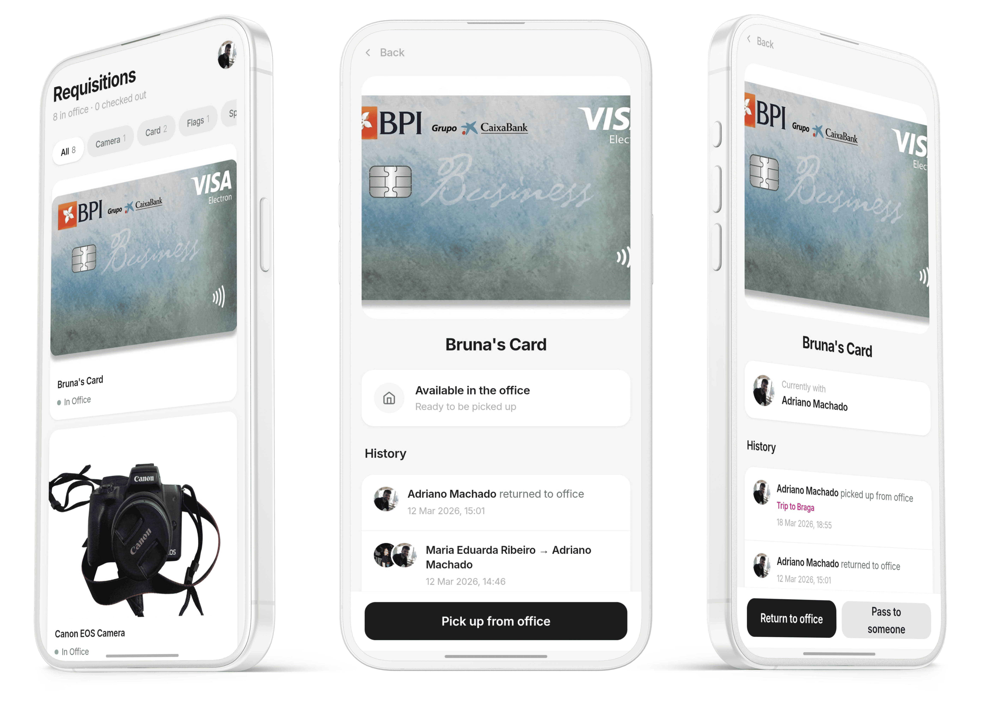

# ESN Porto Requisitions Tracker

A website for ESN Porto volunteers to track and manage office equipment (cameras, cards, etc.). At any moment, users can see what items are in the office, who has them, and a complete history of all transfers.



## Features

* **Real-time Tracking:** See if an item is in the office or held by a volunteer. Pages update live through Supabase Realtime.
* **Audit History:** Append-only timeline of check-outs, returns and peer-to-peer transfers, with optional event name and note per action.
* **Shared ESN Account:** Sign in with the same email + password used in [IT Manager](https://it.esnporto.org). No separate signup, no Google sign-in, no per-app allowlist: who can enter and who is an admin is managed in IT Manager.
* **Roles:** Every ESN volunteer can pick up, return and pass items. Project admins can also manage inventory and categories, upload item photos, and force-return or reassign any item from the item detail page.
* **QR Code / NFC Tags:** Downloadable QR code per item linking to a dedicated QuickScan page.
* **QuickScan Page:** Mobile-first page (`/scan/[id]`) reachable via QR code or NFC tag. Pick up, return, pass or take an item with a single tap.
* **Legacy QR codes keep working:** items keep their old Firestore id in `legacy_id`, so `/scan/<oldId>` and `/item/<oldId>` still resolve after the migration.

## Tech Stack

### Frontend

* [Next.js](https://nextjs.org/) 16 (App Router, React 19, React Compiler, `proxy.js` instead of middleware)
* Tailwind CSS v4
* `@supabase/supabase-js` + `@supabase/ssr`

### Backend & Data

* Self-hosted Supabase shared by all ESN Porto apps (`https://supa.esnporto.org`)
  * Supabase Auth (email + password)
  * Postgres schema `requisitions_tracker` with RLS, SECURITY DEFINER RPCs and Realtime
  * Storage bucket `item-images` for item photos
* Next.js API routes (Node.js) for every mutation

## Getting Started

### Requirements

* Node.js v20+
* npm
* Access to the ESN Porto Supabase instance (anon key; service role key for the upload route)

### Installation

```bash
git clone https://github.com/ESNPorto/requisitions-website.git
cd requisitions-website
npm install
cp .env.example .env   # fill in the keys
npm run dev -- -p 3012
```

The app is available at **http://localhost:3012**. Sign in with your ESN account (the one you use in IT Manager); your profile must have role `volunteer` or `admin` to get past `/no-access`.

### Environment variables

| Variable | Scope | Value |
|----------|-------|-------|
| `NEXT_PUBLIC_SUPABASE_URL` | build + runtime | `https://supa.esnporto.org` |
| `NEXT_PUBLIC_SUPABASE_ANON_KEY` | build + runtime | anon key (RLS applies) |
| `SUPABASE_SERVICE_ROLE_KEY` | **server only** | used by `/api/upload` and `/api/project-config`; never in the browser, never in the image |
| `NEXT_PUBLIC_PROJECT_SLUG` | build + runtime | `requisitions_tracker` (must match `public.projects.slug`) |
| `NEXT_PUBLIC_PROJECT_NAME` | build + runtime | `Requisitions Tracker` |
| `NEXT_PUBLIC_SUPABASE_SCHEMA` | build + runtime | `requisitions_tracker` |
| `NEXT_PUBLIC_APP_URL` | build + runtime | `http://localhost:3012` locally, `https://requisitions.esnporto.org` in production |
| `NEXT_PUBLIC_IT_MANAGER_URL` | build + runtime | `https://it.esnporto.org` |

`NEXT_PUBLIC_*` values are inlined by Next.js at build time, so in Docker they are passed as build args (see `Dockerfile`). `.env` is listed in `.dockerignore` on purpose.

### Database

The whole backend is one SQL file: `supabase/migrations/20260905120000_supabase_backend.sql` (tables, views, RPCs, RLS, grants, realtime publication, storage policies, PostgREST exposure). The design is documented in comments inside the file.

It was applied on the VPS as `supabase_admin` (not `postgres`, because the views must be owned by a role that bypasses RLS on `public.profiles` / `it_manager.volunteers`):

```bash
docker exec -i supabase-db psql -U supabase_admin -d postgres -v ON_ERROR_STOP=1 \
  < supabase/migrations/20260905120000_supabase_backend.sql
```

The file is transactional up to the PostgREST `ALTER ROLE authenticator ... pgrst.db_schemas` statement, which must run outside the transaction. It is safe to re-run on an empty schema; it drops and recreates the `requisitions_tracker` tables, so do **not** re-run it once data has been imported.

## Access control

Identity and permissions live in IT Manager's shared `public` schema, not in this app.

| Question | Answered by | Who qualifies |
|----------|-------------|---------------|
| Can this user enter? | `public.has_project_access('requisitions_tracker')` | `profiles.role` is `volunteer` or `admin` (project `access_level = staff_only`) |
| What can this user do here? | `requisitions_tracker.can(key)` / `requisitions_tracker.my_capabilities()` | Tier `use` keys: anyone with project access. Tier `manage` keys: project access **and** project admin (ESN admins, or a `public.user_project_access` row for `requisitions_tracker` with role `admin`) |

Capabilities are keys `requisitions.<resource>.<action>`, listed in `requisitions_tracker.capabilities`:

| Key | Tier | Used in the app for |
|-----|------|---------------------|
| `requisitions.inventory.view` | use | reading items, categories, history, volunteers (RLS) |
| `requisitions.items.checkout` / `.return` / `.transfer` | use | `move_item` (pick up, return, pass, take) |
| `requisitions.items.override` | manage | `admin_move_item` (force-return, assign), `/api/items/:id/admin-move`, admin controls on the item page |
| `requisitions.catalogue.manage` | manage | creating/editing/deleting items and categories, photo upload, `/admin` |
| `requisitions.audit.view` | manage | reading `catalogue_audit` (RLS) |
| `requisitions.access.manage` | manage | granted in IT Manager, not used by this app |

A volunteer gets the 4 `use` keys, a Requisitions admin gets all 8, anyone else gets none. The database (RLS + RPCs) enforces every key; the API routes check them again server-side; the UI reads `my_capabilities()` only to hide buttons.

To change who can do what, use **IT Manager** (`https://it.esnporto.org`):

* **Give someone access:** make them a volunteer (set the profile role to `volunteer`). Newly onboarded volunteers get it as part of the normal IT Manager flow. No action is needed inside this app.
* **Make someone an admin of this app:** in IT Manager, grant role `admin` on project `requisitions_tracker` (this writes a row to `public.user_project_access`). ESN admins (`profiles.role = admin`) are admins everywhere automatically.
* **Remove access:** demote the profile (e.g. alumni) or remove the project role in IT Manager. The change is effective on the next request; there is nothing to sync.

Routing (`proxy.js` -> `lib/supabase/middleware.js`): no session -> `/login?next=...`; session without project access -> `/no-access` (which links to IT Manager). `/login`, `/forgot-password`, `/auth/*`, `/no-access` and `/api/project-config` are reachable without a session; `/reset-password` needs a session but not project access (the recovery link signs the user in first). Password recovery uses the shared GoTrue account, so a password changed here also changes it for IT Manager.

## Architecture

```
Browser (Next.js client)
  |  reads: supabase-js + anon key + user session  -> RLS  -> items_view, categories, transfers, volunteers
  |  realtime: postgres_changes on items / transfers / categories -> refetch
  |  writes: fetch() to /api/*  (never straight to the DB)
  v
Next.js server (proxy.js + app/api/*)
  |  session check on every route (requireUser / requireCapability(key))
  |  user-scoped client  -> RPC move_item / admin_move_item, inserts/updates on items & categories
  |  service-role client -> Storage bucket item-images (after the catalogue.manage check), public.projects
  v
Supabase (supa.esnporto.org)
  auth.users, public.profiles, public.projects, public.user_project_access   (owned by IT Manager)
  requisitions_tracker.{categories, items, transfers, volunteers, items_view, move_item(), admin_move_item()}
  storage.objects (bucket item-images, public read)
```

### Schema `requisitions_tracker`

| Object | Purpose |
|--------|---------|
| `categories` | id, `key` (slug), `name`, `sort_order` |
| `items` | id, `legacy_id` (old Firestore id), name, category, `photo_url`, `status` (`office` / `out`), `holder_id`, `holder_name` snapshot |
| `transfers` | Append-only audit log (`pickup` / `return` / `transfer`, from/to, event, note, `admin_override`, `performed_by`). No update/delete grants exist. |
| `volunteers` (view) | Roster read from `public.profiles` + `it_manager.volunteers`; returns zero rows to non-staff |
| `items_view` (view) | Items joined with category and resolved holder (`security_invoker`) |
| `move_item(p_item_id, p_action, p_to_user, p_event_name, p_note)` | Volunteer actions `pickup` / `return` / `pass` / `take`. Locks the item, validates the rule, writes the audit row and updates the item in one transaction. |
| `admin_move_item(p_item_id, p_action, p_to_user, p_note)` | Admin actions `return` (force-return) / `assign`. Same guarantees, flagged `admin_override`. |

`status` and `holder_*` can only change through the two RPCs (column-level UPDATE grants exclude them), so every movement leaves an audit row even if someone talks to PostgREST directly.

### API routes

All routes verify the session server-side (401 without one). Admin routes also call `requireCapability(key)`, which reads `my_capabilities()` and returns 403 when the key is missing (fails closed on any error).

| Route | Who | What |
|-------|-----|------|
| `POST /api/items` | `requisitions.catalogue.manage` | create item |
| `PATCH /api/items/:id` | `requisitions.catalogue.manage` | rename / recategorise / change photo (status and holder are not editable here) |
| `DELETE /api/items/:id` | `requisitions.catalogue.manage` | delete item and its photo |
| `POST /api/items/:id/move` | volunteer | `move_item` as the caller: `pickup`, `return`, `pass`, `take` (the RPC checks the key per action) |
| `POST /api/items/:id/admin-move` | `requisitions.items.override` | `admin_move_item`: `return`, `assign` |
| `POST /api/categories` | `requisitions.catalogue.manage` | create category |
| `PATCH` / `DELETE /api/categories/:id` | `requisitions.catalogue.manage` | rename / delete (items keep existing without category) |
| `POST /api/upload` | `requisitions.catalogue.manage` | multipart image -> Storage `item-images` (service role, magic-byte type check, 10 MB) |
| `GET /api/project-config` | public | project metadata from `public.projects` for the login page |

### Project structure

```
requisitions-website/
├── app/
│   ├── admin/            # Inventory & categories management (admins)
│   ├── api/              # Route handlers listed above
│   ├── auth/callback/    # Supabase auth callback
│   ├── item/[id]/        # Item detail, history, admin overrides
│   ├── login/            # Email + password sign-in (shared ESN account)
│   ├── forgot-password/  # Sends the GoTrue recovery e-mail
│   ├── reset-password/   # Sets the new password after the recovery link
│   ├── no-access/        # Shown to signed-in users without project access
│   ├── scan/[id]/        # QuickScan page (uuid or legacy id)
│   └── page.js           # Dashboard
├── components/           # ItemCard, TransferModal, UserMenu
├── contexts/             # AuthContext (session + capabilities, can(key))
├── lib/
│   ├── auth/permissions.js   # requireUser / requireCapability, getCapabilities (my_capabilities), has_project_access
│   ├── auth/capabilities.js  # capability key constants used by routes and UI
│   ├── supabase/             # client, server, admin (service role), middleware
│   ├── data.js               # live query hooks (items, categories, transfers, volunteers)
│   └── storage.js            # bucket name + URL helpers
├── proxy.js              # Next 16 middleware: session refresh + access redirects
├── supabase/migrations/  # The SQL backend
├── scripts/firestore-migration/  # One-off Firestore -> Supabase import (remove after cutover)
├── docs/MIGRATION.md     # Cutover runbook
└── Dockerfile
```

## Deployment

Production runs on the ESN VPS as container `item_tracker` (service `item-tracker` in `/root/n8n/docker-compose.yml`), behind Nginx Proxy Manager at `https://requisitions.esnporto.org`. The image is built locally from this directory:

```bash
cd /root/n8n
docker compose build item-tracker && docker compose up -d item-tracker
```

The compose service must pass the `NEXT_PUBLIC_*` variables as `build.args` and inject `SUPABASE_SERVICE_ROLE_KEY` at runtime through `env_file: ../requisitions-website/.env`. The image contains no `.env` and no `public/uploads` volume (photos live in Supabase Storage). The exact compose changes are in `docs/MIGRATION.md`.

The other ESN Porto apps (GitHub org `ESN-Porto`) deploy through GitHub Actions -> GHCR -> `deploy <name>` over restricted SSH. This repository is still in the older `ESNPorto` org and keeps the local build for now; moving it to the shared pipeline is a follow-up.

## Migrating from Firebase

The production app still on Firebase Auth + Firestore is replaced by this branch. The step-by-step cutover (data import with `scripts/firestore-migration`, compose changes, smoke tests, rollback, cleanup) is in [`docs/MIGRATION.md`](docs/MIGRATION.md).
